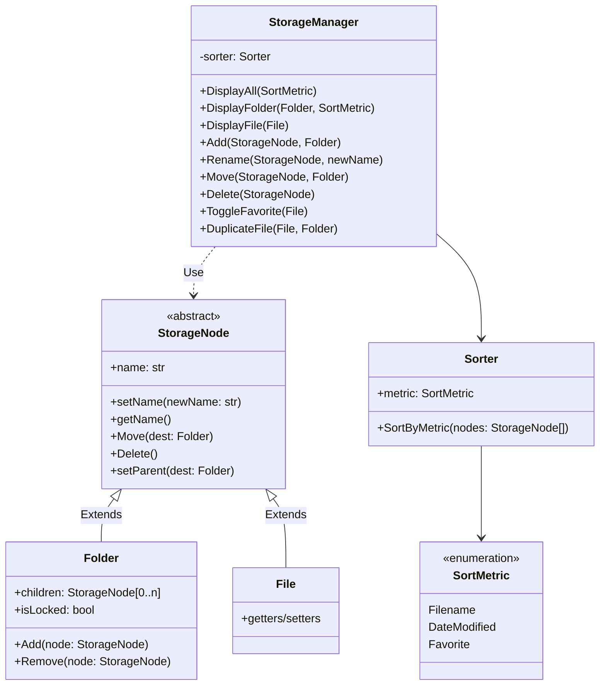

# Storage Subsystem — Facade + Composite Pattern

Documents the current design of the Journaling Program's storage subsystem
(`backend/Journaling/` in the `Journaling_Program` repository), superseding
the previous Command-pattern / `ItemActionHistory` design.


## Class diagram



- **Facade pattern:** `StorageManager` is the single entry point callers use
  to browse, add, rename, move, delete, favorite, and duplicate storage
  nodes — callers never touch `Folder`/`File` tree-mutation methods
  directly.
- **Composite pattern:** `StorageNode` is the abstract base (stores just
  `name`, since Python has no interface construct); `Folder` and `File` both
  extend it. `Folder` is the composite — it stores/removes files *or*
  folders as children — while `File` is the leaf.

## Folder structure

`StorageManager`'s root folder (`Root`) always contains exactly three
subfolders, each protected from deletion:

```
Root
├── Favorites   (files only; duplicates allowed — see ToggleFavorite)
├── Input       (plain folder — files/subfolders added or moved freely)
└── Output      (plain folder — files/subfolders added or moved freely)
```

- **Favorites** only accepts `File`s (no subfolders). A file isn't moved
  into Favorites — `ToggleFavorite(file)` appends the *same* file object
  reference into Favorites' children, so a file can live in its real folder
  and show up in Favorites at the same time. Because of that shared
  reference, `Move()` refuses to relocate a node out of Favorites directly;
  it duplicates the node into the destination instead, leaving the
  original (and its Favorites membership) untouched.
- **Input** and **Output** are ordinary folders: any `StorageNode` (file or
  subfolder) can be added, moved into, or moved out of them without
  restriction.
- **Root**, **Favorites**, **Input**, and **Output** themselves cannot be
  deleted (`StorageManager.Delete` refuses).
